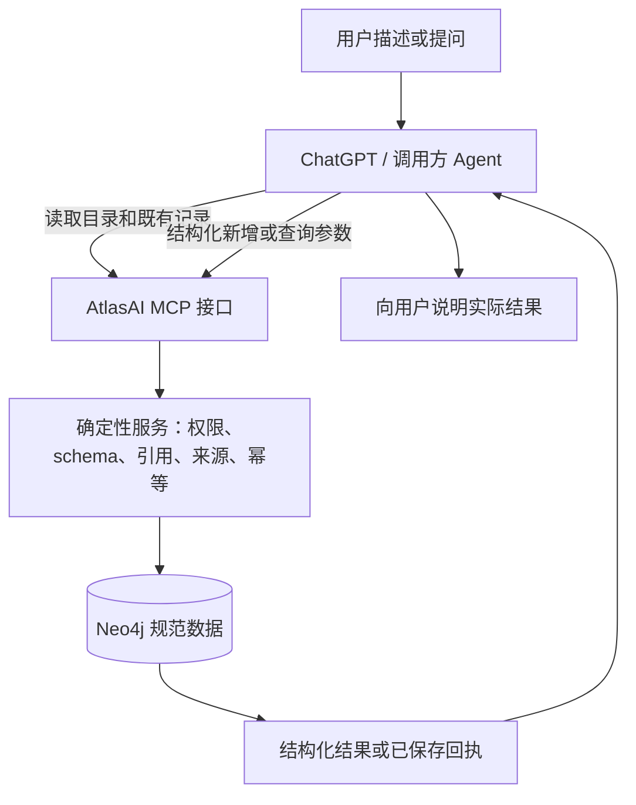

# AtlasAI 知识管理 MCP 完整改造方案

> 2026-11-12 范围更新：用户已确认并授权按 M00–M09 实施[修改删除扩展方案](AtlasAI知识管理MCP修改删除扩展方案与单元计划-2026-11-12.md)。本文“仅新增与查询、禁止修改删除”描述原 v1 范围；相关限制由扩展方案取代。无后端模型、Neo4j 直连、来源、空间隔离及正式发布授权规则继续有效。候选/上线状态以开发进度为准。

日期：2026-11-11  
状态：用户已明确本方案的架构方向；本文是待实施设计，不代表代码、迁移、接入或发布已完成。  
首个调用客户端：ChatGPT；后续客户端通过相同 MCP 契约接入。  
范围：调用 Agent 生成结构化参数；后端不调用 LLM、不使用 Graphiti，直接连接 Neo4j，只记录与查询，不设置操作确认流程。

## 1. 目标与不可变边界

1. 自然语言理解、意图判断、实体/事实提取、查询条件组织、同义词扩展和回答生成全部交给调用方 Agent。
2. AtlasAI 后端只做确定性的身份与权限校验、参数与引用校验、来源保存、幂等、事务写入、检索和精确计算。
3. 后端无生成式模型调用、无内部 Agent/Intent Analyzer、无 Graphiti；首版也不调用 embedding、reranker、OCR、语音识别或其他模型服务。
4. Neo4j 是唯一业务数据库；保留对象、事实、关系、收到的来源、记录回执和必要审计。数据库不直接暴露给 Agent。
5. 只新增记录与读取，不提供更正、覆盖、合并、删除、撤回、归档、恢复、审批、工作流、应用结构修改或任意代码执行。
6. 无预览、待确认标志、确认卡、批准页面、审批 token 或 `confirm/commit/apply` 工具。有效新增请求直接在事务中保存并返回真实回执。
7. 登录、空间授权和必要的输入纠错不属于操作批准流程，继续保留。调用客户端自身的连接授权/工具提示不由 AtlasAI 承诺取消。
8. Frappe 已归档，不是依赖，也不是默认的后续开发阶段。不同于当前产品范围的新需求必须另行确定。

## 2. 架构与责任划分



| 职责 | 调用方 Agent | AtlasAI 后端 |
| --- | --- | --- |
| 理解自然语言 | 负责 | 不再次分析 |
| 提取对象、事实和关系 | 按公布的 schema 生成参数 | 验证结构及已存在引用，不重新抽取 |
| 选择类型、谓词和对象 | 先读目录，必要时查候选 | 返回真实目录，核验 ID，不按近似姓名合并 |
| 查询 | 生成受限条件，解释结果 | 编译受控查询并精确计算 |
| 保存 | 调用新增工具 | 检查权限和来源，在事务中写入 |
| 成功判定 | 根据工具回执回答 | 提供持久化真实回执，不依赖模型宣称完成 |

调用 Agent 可能生成错误数据；后端能检查结构和一致性，不能在没有独立证据的情况下证明事实为真。不得把格式校验通过写成“事实已核实”。

## 3. 首版工具契约

采用官方 Python MCP SDK、Streamable HTTP 和 HTTPS `/mcp`。工具以独立、明确的 schema 注册，返回 `structuredContent` 与简短说明。协议版本、SDK 版本及 OAuth 方式在 ChatGPT 真实接入验证后锁定，不盲目使用客户端未支持的新协议特性。

| 工具 | 最小输入 | 主要输出 | 业务副作用 |
| --- | --- | --- | --- |
| `get_context` | 目录类别、类型/谓词筛选、分页、可选已授权空间选择 | 当前账号、空间、权限、schema 版本、图谱词汇及约束、目录完整性和版本 | 无 |
| `find_records` | 关键词、类型/编号等结构化筛选、分页 | 对象或来源候选、总数/范围、完整性和版本 | 无 |
| `get_record` | 对象 ID、事实分页参数、可选历史读取 | 对象、事实、关系、派生资格及来源引用 | 无 |
| `query_records` | LIST / COUNT / GROUP / SUM、类型、筛选、字段、单位和分页 | 数据库结果、计数口径、缺失/冲突/排除说明 | 无 |
| `get_sources` | 来源/事实 ID、分页参数 | 当前权限允许的实际收到文本、摘录与来源元数据 | 无 |
| `record_information` | schema 版本、稳定请求 ID、来源、实体、事实 | 保存状态、服务端 ID 映射、真实数量、版本和回执 | 新增知识及回执 |
| `get_receipt` | 原记录请求 ID | 当前账号及空间内该请求的已保存结果或未发现 | 无 |

`get_receipt` 只解决超时后的保存结果核对，不是审批、预览或人工确认任务。首版不另建通用工作流/任务平台。

工具不得接受 `actor`、任意 `dataset`、数据库地址、模型名称/密钥、Cypher、审批标志或自定义执行脚本。账号与数据集从认证结果派生；若允许选择空间，只能选择后端验证已授权的空间标识。

读工具不得修改业务知识；必要访问日志和审计与业务写入分开。`record_information` 必须如实标注为写工具，不能靠伪装只读来避免客户端提示。首版先完成普通 ChatGPT MCP 工具调用，不承诺公司知识专用 `search/fetch` 协议、插件商店提交或自定义 UI；如需要这些能力，再添加经过单独验证的兼容适配。

### 3.1 Agent 需要的上下文：schema、词汇与相关记录

结构化输入有两个层面：格式符合工具 schema，以及对象身份、类型、谓词和关系与已有知识一致。仅向 Agent 提供 JSON 字段定义不能自动解决第二个问题，必须通过以下三类上下文配合：

| 上下文 | 内容 | 获取方式 |
| --- | --- | --- |
| 工具输入 schema | 必填字段、类型、枚举、引用格式、互斥条件、大小及版本限制 | MCP 工具定义；契约变更时刷新客户端元数据 |
| 图谱词汇与约束 | 已有对象类型、谓词、主客体类型、关系方向、单值/多值、数值单位规则及身份命名空间规则 | `get_context` 定向筛选与分页 |
| 相关对象与局部关系 | 候选 ID、编号/命名空间、当前事实、相关关系、资格及来源引用 | `find_records` → `get_record`，必要时 `get_sources` |

后端只返回 Neo4j 中实际可访问的目录和记录，以及确定性契约约束；不让后端 LLM 选择上下文、总结图谱或做语义重排。首版不额外引入一个图谱问答 Agent。

### 3.2 目录返回与完整性

`get_context` 的目录查询区分 types / predicates / identity_rules 等类别，并支持按 kind、predicate 等精确筛选。关系类型用数据字段描述，不动态生成大量 MCP 工具。类型、谓词和每个对象的事实/邻接关系分别分页，不能以“只有一页类型”为由返回某个类型下无界的全部谓词或对象。

以下是谓词目录的设计示例，不是当前已部署结果：

```json
{
  "schema_version": "1.0",
  "workspace_id": "workspace-example",
  "catalog_revision": 7,
  "data_revision": 12,
  "directory": "predicates",
  "rows": [
    {
      "subject_kind": "Organization",
      "predicate": "city",
      "value_type": "text",
      "cardinality": "one",
      "direction": "out",
      "unit_policy": "none"
    },
    {
      "subject_kind": "Organization",
      "predicate": "contact",
      "value_type": "entity",
      "target_kind": "Person",
      "cardinality": "many",
      "direction": "out"
    }
  ],
  "limit": 25,
  "has_more": false,
  "next_cursor": null,
  "complete": true
}
```

单位规则与值类型应来自已经登记的约束；没有明确规则时如实说明未知，不由后端猜测。返回的完整性只针对本次类别及筛选范围，不代表整张图谱完整。

目录当前页未出现某个名称，不代表该词汇不存在。Agent 应先做定向查询或继续分页，再决定是否创建有来源依据的新类型或谓词；不能仅凭首次返回的目录自行发明同义名称。格式相同、名称相似也不自动证明两个业务概念相同。

### 3.3 生成结构化参数的调用顺序

1. 获取工具 schema 和当前授权空间的相关目录；有同版本缓存时只补充缺少部分。
2. 根据用户实际输入，通过 `find_records` 查找可能已有的对象。优先使用明确编号/命名空间，再结合名称与类型查候选，不根据姓名自动合并。
3. 对拟引用对象调用 `get_record`，获取完成本次任务所需的事实及一层关系。需要核对来源时再调用 `get_sources`；需要更多事实或关系时继续显式分页。
4. Agent 根据实际结果生成参数：已有对象使用真实 `entity_id`，新对象使用本次局部 ref；复用适用的既有类型、谓词、方向和基数，保留实际传入来源及不确定性。
5. 调用 `record_information`，后端在保存事务中重新核验权限、对象 ID、身份约束、谓词兼容性及来源，然后返回真实保存回执。
6. 查询场景先完成所需词汇与对象解析，再调用 `query_records`；不能把局部上下文中的对象或关系数量当成整个查询范围的统计。

这些步骤都是按需的机器工具调用，不是用户确认流程。不要求每次录入重新读取所有目录或遍历已有图谱，也不为查询之外的无关上下文增加调用。

### 3.4 上下文范围、缓存与并发变化

- 不在连接建立或每轮对话时发送整张图谱。只返回当前账号有权访问、与所请求条件对应的目录、候选和局部记录；无关对象、全文和私有来源不随目录打包。
- `catalog_revision` 表示词汇/约束版本，`data_revision` 表示业务数据版本；权限需每次核验，缓存不能延长已撤销的数据访问权。
- 缓存按认证身份、空间、schema/目录版本和筛选范围区分。换账号、换空间或相关版本改变时重新获取，不能把旧客户端聊天历史视为最新数据库快照。
- 跨页仍遵循第 7 节的稳定版本和游标规则。上下文不完整时明确返回 has_more/complete，不能默认后端已替 Agent 检查全部对象。
- 目录或候选发出后数据可能变化，保存时必须检查当前引用和约束；失效、无权限或不兼容时返回结构化错误，由 Agent 重新查询。无关对象新增不应无条件导致所有独立新增失败，但不能绕过实际相关的唯一身份与并发幂等约束。
- 这些核验只能防止非法引用和结构不一致，不能保证 Agent 将一个合法 ID 对应到用户真正想表达的业务对象；保留来源和明确歧义处理，不宣称自动验证了全部语义。

### 3.5 验收要求

必须验证：目录超过一页、目录筛选无结果、同名多对象、关系方向/单多值不同、同义名称选择、局部关系超过一页、上下文读取后身份或权限变化、换空间后的缓存隔离，以及仅凭局部图谱不能生成全空间统计。

对“为示例公司补充联系人 Alex”的端到端测试，应观察到 Agent 查询公司和联系人候选、读取必要详情、选择实际 ID 或明确创建独立对象，再提交结构化记录；不能仅凭名字或模型记忆生成已有 ID。相关测试同时在禁用后端模型端点、未安装 Graphiti 的环境中通过。

## 4. 结构化新增输入

下面是拟定的 v1 业务契约示例，不是已部署 API。实现时为每个字段生成严格 JSON Schema，禁止额外字段，使用明确枚举、类型、长度和互斥规则。

```json
{
  "schema_version": "1.0",
  "request_id": "example-record-001",
  "recording_mode": "structured",
  "sources": [
    {
      "ref": "s1",
      "text": "Atlas Demo Logistics 位于 Chicago，联系人为 Alex。",
      "external_ref": ""
    }
  ],
  "entities": [
    {
      "ref": "company",
      "action": "create",
      "kind": "Organization",
      "name": "Atlas Demo Logistics",
      "identifier": "",
      "namespace": "",
      "quotes": [{"source_ref": "s1", "quote": "Atlas Demo Logistics"}]
    },
    {
      "ref": "contact",
      "action": "create",
      "kind": "Person",
      "name": "Alex",
      "identifier": "",
      "namespace": "",
      "quotes": [{"source_ref": "s1", "quote": "联系人为 Alex"}]
    }
  ],
  "facts": [
    {
      "subject_ref": "company",
      "predicate": "city",
      "value": {"type": "text", "text": "Chicago"},
      "cardinality": "one",
      "certainty": "asserted",
      "quotes": [{"source_ref": "s1", "quote": "位于 Chicago"}]
    },
    {
      "subject_ref": "company",
      "predicate": "contact",
      "object_ref": "contact",
      "cardinality": "many",
      "certainty": "asserted",
      "quotes": [{"source_ref": "s1", "quote": "联系人为 Alex"}]
    }
  ]
}
```

契约细则：

- `recording_mode=structured` 时至少有一个实体或事实。实体可 `create` 或 `reference`；reference 必须使用真实且可访问的 `entity_id`，不得带字段更改。
- reference 的字段仅为 `ref/action/entity_id`，不接收新的 name/kind/identifier/namespace；原有对象信息由后端读取，避免以“引用”偷偷更名。
- 只有创建实体可提供名称、编号和类型；内部 `ref` 只用于本次请求引用，持久 ID 由后端生成。
- 事实的字面值 `value` 与关系目标 `object_ref` 二选一；主语和关系目标只能引用本次合法实体定义。
- 类型和谓词属于开放业务数据，不按“客户”“合同”等词硬编码。已有目录名称应优先精确复用；同义关系由 Agent 提出，后端不偷偷重命名或合并。
- 每个事实和新实体都必须引用本次实际传入的来源。摘录必须是对应 `sources.text` 的连续原文子串；服务端记录真实接收时间和认证记录人。
- `certainty` 区分 `asserted/estimated/uncertain`。`asserted` 仅表示传入陈述没有表达不确定性，不表示已由人工审核或客观核实。
- 数值采用十进制字符串，单位/币种单独提供；金额单位必须有对应来源摘录，不能凭地区推测 USD。标识也按字符串处理，保留前导零。
- 字面值 v1 仅支持 `{"type":"text","text":"..."}` 和 `{"type":"number","decimal":"123.45","unit":"USD","unit_quotes":[...]}`，关系使用 object_ref。日期等未增加专门类型前按有来源的文本保留，不猜时区或时间范围。
- `cardinality=one/many` 要与已有谓词约束兼容，不能通过新请求把单值槽改成多值槽以绕过冲突处理。
- 无法可靠结构化时允许明确使用 `source_only`：只保存收到文本及来源元数据，entities/facts 为空；可通过来源搜索取回，不计作结构化对象或事实，也不进入相应精确统计。这是完整保存的一种类型，不是待确认状态。

首版建议边界：每次最多 8 份来源、来源合计 16,000 字、40 个实体、100 条事实；JSON 正文另设 256 KiB 上限。超限整体拒绝，不自动拆成无法保证完整性的多笔写入。更大批量导入不属于首版。

## 5. 新增、身份、重复和冲突规则

### 身份

先通过 `find_records` 查目录和候选，再引用已存在 ID；仅名称相似不能作为自动合并依据。明确编号可按“当前空间 + 类型 + 命名空间 + 规范编号”确定唯一身份；规范化规则保持版本化，不能剥掉有意义的标点或前导零。

`create` 命中已有明确唯一标识时返回 `IDENTITY_CONFLICT` 和可访问候选，整笔不写；Agent 重新组织为 reference 后再提交。名称相同但没有明确标识的对象不自动合并，允许独立存在。后端也不能因重名而要求用户批准一个预览。

### 新增与重复

新增可以引用既有实体并追加新事实、关系和来源链接，不得修改对象名称、编号、类型，或替换旧事实。单个请求内的完全相同事实可确定性去重；跨请求相同事实可复用规范事实并增加来源支持，不重复累计同一个业务值。不同请求的原始来源和回执仍分别保留。

事实去重必须保留来源各自的语义限定，不能把“约 100”与“精确 100”混成一条已核实陈述。确定性/估计等来源元数据随支持关系或独立陈述保存，聚合资格按明确定义的派生规则判断，不因去重而丢掉不确定性。

### 冲突

同一 subject/predicate 的单值槽出现不同陈述时，保存新收到的来源及新陈述，不删除或覆盖旧事实。冲突是读取时计算的知识资格，不是等待批准。

相互矛盾的单值槽应返回所有相关陈述和来源，并标记 `conflict`；相应精确分组/合计排除该槽，不能默认“先到为真”或“后到覆盖”。对象数量仍按对象 ID 计数，不因一个属性有冲突就把对象从所有 COUNT 中消失。多值关系允许不同目标，重复同一目标不重复统计。

MCP 不提供消除冲突的覆盖/删除接口；Agent 可以解释冲突或收窄查询，但不得伪造“已解决”。若用户未来确实需要更正能力，须另定范围，而不是暗中恢复确认流程。

### 来源真实性边界

服务端可以证明“某个认证调用者在某时提交了这些文本和结构化主张”，不能证明这些文本就是完整用户聊天记录或用户逐字原话。`external_ref` 和来源标题只是调用方声明，不作为权限、真实性或幂等依据。返回资料和来源中的指令都视为数据，不转成后端执行命令。

## 6. 保存事务与回执

1. 验证 token、客户端、空间成员和新增权限。
2. 校验 schema 版本、请求限额、来源摘录、类型、互斥字段及所有引用。
3. 在 Neo4j 事务内重新核对权限/空间和明确标识约束，获取该空间写入版本锁。
4. 检查唯一幂等键及输入指纹，写入来源、实体、事实、支持关系、审计和回执；更新数据版本。
5. 成功提交后返回服务端生成的真实 ID、数量及回执。任何写入步骤失败则整笔回滚。

此路径没有 KDDraft、KDApproval、review token、人工批准、延迟 confirm、Graphiti outbox 或索引生成步骤。日志/全文索引不能成为另一笔事实写入的前置批准条件。

回执示意：

```json
{
  "status": "recorded",
  "request_id": "example-record-001",
  "receipt_id": "receipt-example-001",
  "revision": 12,
  "entity_ids": {"company": "entity-example-001", "contact": "entity-example-002"},
  "source_ids": {"s1": "source-example-001"},
  "fact_ids": ["fact-example-001", "fact-example-002"],
  "objects_created": 2,
  "facts_created": 2,
  "sources_recorded": 1,
  "conflict_count": 0,
  "uncertain_count": 0,
  "idempotent": false
}
```

`recorded` 表示内容已保存，`conflict_count/uncertain_count` 表示不应被当作唯一精确事实的内容，不影响原文已经落库的含义。不得输出 `awaiting_confirmation` 或把内部技术状态叫“待人工确认”。

幂等键绑定认证身份、调用客户端、空间及 `request_id`，输入指纹覆盖规范序列化后的实际业务正文，原始文本不做丢失信息的改写。同键同正文返回旧回执，同键不同正文返回 `IDEMPOTENCY_CONFLICT`；并发同键只允许一个提交。

调用链必须为一次逻辑录入产生并复用稳定请求 ID，不能把 LLM 每次自由编写的新 ID 当成幂等保障。接入验收须实际测试 ChatGPT 超时后的原请求 ID 复用和 `get_receipt`；若客户端缺少可靠自动重试上下文，应先取回旧回执，不能自动换 ID 重发。模型重新生成不同参数属于新输入，不得伪称网络重试。

请求超时不等于保存失败。`get_receipt` 只能返回当前调用者/空间的持久化结果；未发现回执可能意味着尚未提交，随后仍须用同一个请求 ID 和相同正文重试。不能提供一个通用“再执行”工具。

## 7. 查询契约、精确统计与搜索

`query_records` 接受受限结构，不接受自然语言或 Cypher。示例：

```json
{
  "schema_version": "1.0",
  "operation": "COUNT",
  "kind": "Organization",
  "filters": [
    {"predicate": "city", "operator": "eq", "value": {"type": "text", "text": "Chicago"}}
  ],
  "limit": 25,
  "cursor": null
}
```

- 固定操作为 LIST / COUNT / GROUP / SUM；首版以对象为主计数单位，事实详情通过 `get_record` 获取。来源独立存在，不计入对象数量。
- 公共查询字段为 schema_version、operation、kind、object_ids、filters、predicate、unit、direction、limit、cursor；GROUP/SUM 使用 predicate 指定属性。游标由服务端签发并绑定调用空间、参数和 revision，不能用任意字符串切换数据范围。
- 筛选最多 8 项；操作符限定 eq / in / exists / gt / gte / lt / lte，并校验类型、关系方向、对象引用和列表大小。服务端使用固定模板及参数，不拼接用户表达式或开放任意标签/属性执行。
- GROUP 与 SUM 必须指定字段，SUM 必须指定单位（无量纲用明确空单位）；使用 Decimal/固定精度存储和计算，禁止浮点近似金额及隐含汇率换算。
- 复用现有数值精度和溢出拒绝原则；若无法无损表达输入则返回错误，不四舍五入伪造精确值。
- 返回 `count_unit`、匹配对象数、参与数、缺失/估计/冲突/单位不匹配排除数及原因。缺失金额不当作已知 0，搜索命中数不当作业务总量。
- 每页默认 25、最多 100；后端返回稳定排序、数据 revision、绑定筛选指纹的分页游标、`has_more` 及当前页是否完整。后续页数据版本变化时返回 `REVISION_CHANGED`，不悄悄拼接不同快照。
- 精确 COUNT/SUM 必须针对完整匹配范围计算，不对第一页做汇总。聚合计算是否完整和明细是否还有分页分别表达；处理超过资源限额应拒绝，不返回部分数字冒充总量。
- `get_record` 的大事实列表、邻接关系和 `get_sources` 也必须分页，不能偷偷截断；首版关系展开限制一层，防止无界路径查询。

搜索先实现编号/名称等字段匹配、关键词、类型与关系筛选；需要全文搜索时直接采用 Neo4j 5.26 兼容的全文索引接口，测试中英文 analyzer、符号、空查询及长度边界。关键字默认按字面处理，不把 Agent 输入直接当任意 Lucene 语法。

所有匹配和分页都必须在当前授权空间内进行。不得跨空间全局取前 N 条后才过滤并宣称这是完整结果；若全文索引不能提供范围内正确的候选与排序，应使用受限字段匹配并明确当前搜索模式，不绕过租户范围。

全文检索不等于语义检索。同义词、翻译和改写由调用 Agent 生成多个受控检索条件；不承诺首版自动语义召回，也不接向量/embedding 服务。不得以 LLM 或 Graphiti 作为无结果时的隐式回退。

## 8. Neo4j 数据模型与旧数据兼容

优先复用当前 KD 规范标签和 ID，避免因移除 Graphiti 而重建已有知识。复用不代表把旧审批语义继续用到新 MCP：

| 数据 | 目标职责 |
| --- | --- |
| `KDObject` | 固定标签的对象；kind 为数据，ID/编号/空间决定身份 |
| `KDFact` | 属性或对象关系的规范陈述，保留值、精度、单位、基数、来源与时间 |
| `KDSource`、`KD_SUPPORTS` | 实际收到文本、来源支持与摘录；来源可独立保存 |
| `KDWorkspace`、`KDWorkspaceMember` 等 | 当前身份与空间权限映射 |
| `KDMutation` / 新的最小记录审计 | 真实 actor、channel=mcp、直接记录方式及数量 |
| 记录请求/回执节点 | 身份与空间绑定的唯一请求键、输入指纹、结果和提交版本 |

设计层面采用追加陈述与来源、派生统计资格。新数据用 `recorded_at`、`recorded_by`、`origin_channel`、`ingestion_schema_version` 等明确记录实际来源，不伪造 `reviewed_by` 或“人工已批准”。旧 `confirmed/review_status` 若用于兼容，只通过专门映射解释，不暴露为 MCP 审批流程。

新 schema、唯一约束和索引必须有版本化、可重复执行的迁移脚本；先在隔离副本验证。约束至少涵盖空间内明确对象身份、同一作用域请求键以及必要记录 ID。历史数据不符合新约束时先报告，不能通过删除、错误合并或编造审核信息强行过关。

## 9. 身份、权限与运行约束

- 复用 Auth0 用户与现有空间成员关系，单独完成 MCP OAuth 发现、资源 audience、scope、有效期、撤销及 ChatGPT 回调兼容验证；不能把网页登录成功当作 MCP 认证通过。
- 首版 scope 只需要 `knowledge:read` 和 `knowledge:record`。每次工具调用检查授权；Actor、workspace/dataset 与客户端身份不采信模型输入。
- 目录、对象、来源、回执、全文搜索、缓存和分页游标都绑定当前空间与权限。知道 ID 不代表可以读取。
- 输入 schema 中直接不定义 update/delete/approve 字段；额外字段拒绝，服务层也不保留通用执行后门。
- 运行配置仅含 Neo4j、认证、监听、限额和诊断所需项；不得要求 `LLM_*`、`OPENAI_*`、`DEEPSEEK_*`、`EMBEDDING_*`、`GRAPHITI_*` 或第二语义库配置。
- 新服务环境不安装 `graphiti-core`、`pydantic-ai` 或供应商模型 SDK；可以使用 Pydantic 做确定性 schema 校验，不将其等同于 LLM 调用。
- 服务仅访问 Neo4j、认证元数据/公钥和明确的日志基础设施等允许目的地；禁止模型/embedding/重排端点。认证发现不是模型调用，也不能为省外网而省掉认证。
- 记录审计、调用量、延迟、幂等命中、错误类别和 DB 失败；不默认输出来源全文、token 或密码。

## 10. 错误、澄清与用户体验

统一输出可机器读取的错误 code、简短说明、出错字段路径、是否可重试及可访问候选；MCP 工具错误按协议和 SDK 规范表达。最低错误集合包括：

`INVALID_ARGUMENT`、`UNSUPPORTED_SCHEMA_VERSION`、`UNAUTHENTICATED`、`PERMISSION_DENIED`、`REFERENCE_NOT_FOUND`、`IDENTITY_CONFLICT`、`PREDICATE_CONFLICT`、`LIMIT_EXCEEDED`、`IDEMPOTENCY_CONFLICT`、`REVISION_CHANGED`、`SERVICE_UNAVAILABLE`。

错误不生成审批单。Agent 可修正参数、向用户询问真正缺少的信息或说明范围不支持；后端不另起 LLM 来生成问题。不创建“待人工确认”知识状态。

查询为空、全文索引不可用、数据库失败与写入结果未知必须分开表达。冲突/估计已经保存时以成功回执加资格说明表达，不伪报保存失败诱导重复录入。

首版使用 ChatGPT 的对话与工具结果，无自定义确认 UI。典型交互：

1. “记下这段资料” → Agent 查目录并生成结构化参数 → 一次直接保存 → 根据回执说明记录结果。
2. “查一下 Chicago 的公司有多少” → Agent 生成过滤条件 → 数据库完整统计 → Agent 根据结果解释。
3. “这条信息从哪里来” → 读取事实和来源 → 引用实际收到材料。
4. “删掉这些资料” → 明确说明当前工具只支持新增与查询，不调用历史删除/归档接口。

## 11. 现有代码的拆分与取舍

不能直接把 `MobileGateway.chat_submit` 或 `Service.chat` 包装成 MCP 工具。当前 `Store` 还继承索引/待确认相关模块，`_commit` 会调用 `enqueue_indexes`，旧入口会创建 Graphiti worker。直接复用整条链路仍会引入不需要的后台模型和确认依赖。

| 现有内容 | 改造方式 |
| --- | --- |
| `model.py`、部分 contracts | 提取纯 schema、十进制、ID、引用校验，建立独立 v1 输入/输出模型 |
| `store.py` | 复用有明确测试的参数化查询、事务与数据映射；拆出不继承 Graphiti/待确认 mixin 的最小 Neo4j repository |
| `recording_store.py`、`change_service.py` | 复用来源及幂等思想；新增直写路径，不调用 prepare/approve/save-draft/commit 确认链路 |
| `mobile_auth.py` | 复用账号/空间成员校验思想，接入 MCP OAuth；不照搬浏览器 origin 规则作为 MCP 授权 |
| `agent_runtime.py`、模型客户端、问答/表格模型调用 | 从新 MCP 运行入口和依赖中移除，由调用 Agent 承担 |
| `graphiti_adapter.py`、`graphiti_extension.py` | 从新服务移除，不启动双索引、episode、抽取、检索或重排 |
| `index_store.py`、Graphiti worker/outbox 调度 | 新写入不入队；旧任务在切换时冻结保留，不继续触发模型 |
| KDDraft/KDApproval、review UI/审批执行工具 | 新 MCP 不暴露、不依赖，不把批准设计为“后台自动点击” |
| 当前 Flutter 自然语言聊天、语音输入和 HTTP 入口 | 不作为新 MCP 的必要组件，见第 12 节的旧入口处置 |

建议在现有知识项目内增加独立 `mcp_backend` 包，包含 transport/auth/contracts/record_service/query_service/neo4j_repository/migrations，并建立独立依赖锁文件与启动命令。模块名可在实施时按仓库惯例调整，但必须保证启动新入口不会导入并初始化旧模型/Graphiti 对象。

目标是一套轻量 MCP 服务和一个既有 Neo4j 业务数据库，不引入新的 AI Runtime、工作流引擎或另一份业务数据。

## 12. 现有网页、旧接口与最终无模型目标

当前线上 PWA 发送自然语言给后端，不能在移除后端 Agent 后原样保持录入/问答功能。首版 MCP 将 ChatGPT 作为入口，不把重建 Flutter 聊天界面列为前置任务，也不通过继续启动旧模型服务来假装完成“后端无 LLM”。

实施阶段可短期隔离保留旧服务用于对照和回滚，但它明确属于未完成切换的旧系统；试点期间禁止新旧两条写入路径并发修改同一生产数据范围。

最终切换时：

1. 停用旧自然语言写接口、Graphiti worker、语音转写及相应定时服务，撤掉外部可达的旧修改/确认入口。
2. 保留旧代码、配置与备份供回滚，不将旧 `.env` 或模型密钥注入新进程。
3. 旧网页可先由网关转为静态迁移说明，告知当前使用 ChatGPT MCP；不重新构建前端。保留只读网页或增加直达来源页属于可选后续，不阻塞首版。
4. 目标“后端不调用模型”同时覆盖对外接口与后台 worker；若旧服务仍在写入/调用模型，不得宣称最终改造完成。

公开来源链接只有在相应授权页面已实际实现时才发布；不能把当前不存在的对象深链编造成可打开引用。

## 13. 数据核对、迁移与 Graphiti 退役

1. 记录当前 Git/部署版本、空间、对象/事实/来源数量、关联完整性、生命周期和统计真值；备份规范数据及旧语义库，验证恢复方法。
2. 隔离环境使用当前 Neo4j 5.26 兼容副本，不重新从聊天历史抽取或调用 LLM 修复数据。
3. 为新入口添加最少的版本化字段/约束/索引；沿用原对象 ID、事实、来源和成员关系，生成可审阅的迁移差异报告。
4. 已保存知识与未执行操作草稿分开：旧 risky draft、被取消提案及未执行更改不转换成有效知识；原已归档/撤回内容不自动恢复。普通历史兼容记录需明确映射，不伪造人工批准。
5. 核对迁移前后的授权对象集合、来源逐字内容、关系方向、计数及精确金额；新冲突资格规则造成的统计差异须列出原因，不强行凑平数字。
6. 停止 Graphiti 任务生成和 worker，保留旧 episode、索引 head、outbox 与语义库作为封存数据；新服务不访问它们。
7. 第二 Neo4j 容器及旧语义数据的停止/删除是后续独立清理项，先备份并证明无依赖。本方案不授权立即删除容器、卷或任何业务数据。

数据兼容不通过时停止切换并报告，不自动合并、补编来源、批准旧提案或静默丢弃记录。

## 14. 分阶段实施与发布

开发到生产的顺序、授权节点、Git 候选、隔离演练、脚本适配、正式切换及回滚，以[开发到上线流程（2026-11-12）](AtlasAI知识管理MCP开发到上线流程-2026-11-12.md)为执行依据。本节保留功能阶段总览；流程文档不表示已获得开发或正式发布授权。

具体任务按[单元化开发计划（U00–U18）](AtlasAI知识管理MCP单元化开发计划-2026-11-12.md)拆分，每个单元明确输入、范围、依赖、交付、验证和完成条件；当前全部未开始。完整方案规定“做什么”，开发计划规定“如何逐单元交付”，上线流程规定“何时能切换生产”。

| 阶段 | 交付 | 阶段门槛 |
| --- | --- | --- |
| A 契约与依赖隔离 | 严格输入/输出 schema、最小 Neo4j repository、新启动/依赖配置 | 无模型 key、无 Graphiti/模型 SDK，空环境可启动 |
| B 认证与只读 | ChatGPT 连接、OAuth、目录/对象/来源/检索/统计 | 隔离、分页和精确统计真值通过 |
| C 直接记录 | 结构化录入、source_only、来源、冲突、事务、回执 | 无预览/批准，来源合法、幂等与并发测试通过 |
| D 迁移演练 | 真实数据副本核对、旧草稿隔离、停用 worker 演练 | 报告可复核，数据完整，无后台模型调用 |
| E ChatGPT 闭环 | 真实账号中记录 → 查询 → 来源 → 超时恢复 | 多种表述正确选工具；范围外请求拒绝；客户端提示边界说明清楚 |
| F 正式发布 | 已测试分支提交/推送、合并/推送 main、部署和健康核对 | 发布的是已验证提交，不重复构建 Flutter，旧写入路径按切换计划关闭 |

当前旧发布 helper 固定安装旧依赖并启动旧 API；实施时必须增加或适配 MCP 专用发布入口。不能原样运行旧脚本，或只检查旧 session 接口，就报告新 MCP 已发布。

首次生产切换需短暂停写并获取最终备份，再部署新 MCP、运行已验证迁移、完成只读和合成数据小样本验证后开放写入。只读认证失败应返回正确 401/403；不能用绕过认证的健康检查代替真实接入验收。

不为每次发布重复数据库停机或迁移：只有首轮版本迁移或后续明确的 schema 变化才执行对应操作。常规后端发布复用既有部署边界和静态资产，不启动 Flutter 构建。

回滚分两类：开放新写入前，可恢复已验证的旧版本和必要备份；开放新写入后，优先代码回滚或前向修复，必须保留和兼容新记录，不能直接恢复旧数据卷丢弃新增知识。恢复旧 LLM/Graphiti 服务属于明确的回滚操作，不能在新服务失败时自动偷偷回退。

## 15. 必须通过的验收矩阵

| 类别 | 必测场景与判定 |
| --- | --- |
| 架构约束 | 不配置任何模型 key；不安装 Graphiti/内部 Agent/模型 SDK；禁用模型端点网络后记录与查询仍正常；无后台模型任务 |
| 工具范围 | 仅公布本方案工具；不存在 confirm/approve/commit/apply/update/delete/archive/restore/execute_cypher 或隐藏通用执行入口 |
| 无确认录入 | 一次有效调用返回已提交回执，无待确认卡/审批节点；异常不转审批任务 |
| 数据与来源 | 新对象、已有引用、多值关系、编号前导零；跨空间引用拒绝；摘录不匹配整笔回滚；source_only 可取回且不伪造事实 |
| 身份与冲突 | 同名不合并；明确编号重复不能创建第二对象；单值冲突均可读且该槽不进入精确合计；估计原意保留 |
| 幂等与原子性 | 同键同正文、同键异正文、并发同键、提交成功但响应丢失、事务中断；没有半笔事实或重复业务值 |
| 精确查询 | 分页外记录仍计入 COUNT/SUM；对象/事实/来源口径区分；多单位、空集合、缺失、冲突、精度和溢出均符合规则 |
| 检索与分页 | 中文、英文、同义词扩展输入、符号、超限、无结果；无跨空间候选泄漏；revision 变化明确失败 |
| Agent 图谱上下文 | schema、词汇目录和局部记录按需获取；目录/关系分页不漏报；同名不猜 ID；换空间缓存隔离；相关数据变化在保存时重新核验；不发送整图或调用后端模型 |
| 账号与权限 | token 过期/撤销、只读用户、空间切换、直接猜 ID、回执窥探；每次读取和新增都校验 |
| 客户端行为 | 直接/间接表述、追问引用、参数纠错、删除请求、超时后的原请求恢复；不凭自然语言宣称写入成功 |
| 迁移与旧入口 | 旧记录/来源/ID 可查；旧未执行提案不激活；不访问第二语义库；最终旧聊天写入/确认和 worker 已停用 |

验收报告应标记隔离测试、真实 ChatGPT、生产只读检查各自覆盖了什么，不能互相代替。未满足架构约束、身份隔离、原子保存、精确查询或真实客户端闭环时不得正式切换。

## 16. 依据、文档关系与本轮产出

- [MCP tools 规范](https://modelcontextprotocol.io/specification/2026-07-28/server/tools)：输入/输出契约和工具调用；实际版本须与目标客户端兼容。
- [OpenAI MCP 服务开发说明](https://developers.openai.com/plugins/build/mcp-server)：工具 schema、结构化结果、真实读写标注及不依赖自定义 UI 的接入方式。
- [OpenAI MCP OAuth 说明](https://developers.openai.com/plugins/build/auth)：认证发现和每次请求权限验证。
- [Neo4j 5 全文索引](https://neo4j.com/docs/cypher-manual/5/indexes/search-indexes/full-text-indexes/)：原生关键词检索能力；本文不引入向量或生成式模型。
- [当前项目基线](../10-当前基线/项目当前基线-2026-11-11.md)、[架构决策](../30-决策记录/知识管理MCP采用Agent结构化输入与Neo4j直连-2026-11-11.md)、[简要规划入口](AtlasAI知识管理MCP规划-2026-11-11.md)。
- [Datavyx 线上现状](../60-子系统与工具说明/Datavyx线上功能与业务流程说明-2026-11-11.md)继续作为旧系统已部署状态说明，不因本方案而改写成无模型或无 Graphiti。

本轮只完成方案及文档同步；没有修改运行代码、安装依赖、执行数据库迁移、停止服务或发布 MCP。实际实施须按用户后续开发指令及上述阶段门槛推进。
