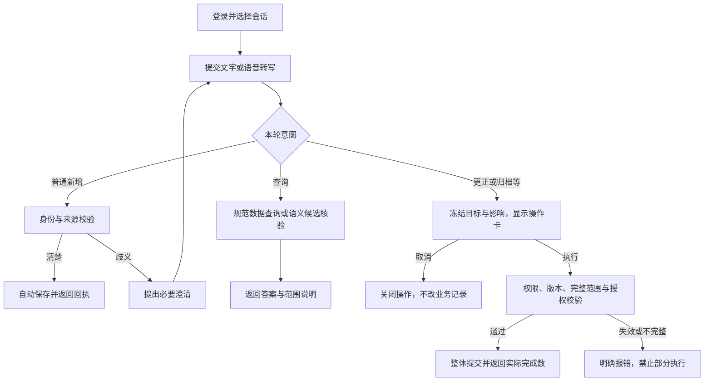

# Datavyx 线上功能与业务流程说明

整理与只读核对日期：2026-11-11  
适用系统：[kb.datavyx.com](https://kb.datavyx.com)，页面名称 Knowledge Assistant。本文不代表 `datavyx.com` 主域名或其他子站的全部功能。  
文档性质：已部署知识管理网页的功能、操作流程和现状说明；不是 MCP 实施完成记录。

## 1. 线上现状与规划边界

目前线上是独立知识管理网页/PWA，用户登录后通过文字或语音记录信息，在对话中查询，并浏览对象、关系、事实和来源。业务类型由录入内容形成，不限于客户、联系人或合同，也不是一套固定 CRM 或 ERP。

必须区分以下三种状态：

| 内容 | 当前状态 |
| --- | --- |
| 已部署网页 | 现有知识管理、普通新增自动保存、查询、对象与来源浏览，以及存量受控修改流程 |
| 新 MCP 产品范围 | Agent 生成结构化参数，后端无 LLM、无 Graphiti，直接接 Neo4j；仅记录查询，无确认/修改工具；尚未开发上线 |
| Frappe 业务操作 | 用户已明确停止，相关文档已归档；不属于线上知识网页的运行依赖，也不是 MCP 后续默认阶段 |

“取消确认流程、只做记录和查询”是当前 MCP 规划要求。最近的文档调整没有部署运行代码，不能据此宣称线上旧确认卡已经移除。后续如需简化现有网页，应另行落实代码修改和发布。

用户随后明确了“Agent 生成结构化参数、后端不调用 LLM、不用 Graphiti”的目标。[完整改造方案](../40-实施计划/AtlasAI知识管理MCP完整改造方案-2026-11-11.md)已经整理；本说明继续记录现有模型、Graphiti 和旧网页的已部署事实，不能直接改写成它们已经停用。

当前方向见[项目基线](../10-当前基线/项目当前基线-2026-11-11.md)，拟实施内容见[MCP 规划](../40-实施计划/AtlasAI知识管理MCP规划-2026-11-11.md)，历史 Frappe 内容见[归档说明](../_archive/Frappe业务操作-2026-11-11/README.md)。

## 2. 功能清单

以下“已部署代码支持”依据线上后端与 Git 版本核对、前端版本校验及源码检查，不等同于本次重新登录后逐项验收。

| 功能 | 用户能做什么 | 当前边界 |
| --- | --- | --- |
| 登录、退出与账号恢复 | 通过 Auth0 登录，恢复可访问的空间 | 登录状态失效或权限撤销后需重新认证 |
| 空间隔离 | 在账号有权限的空间中使用数据 | 身份、成员角色和数据范围由服务端验证；团队创建/邀请未作为本期开放流程 |
| 对话管理 | 新建、切换会话，继续历史对话，分页加载消息 | 处理中限制切换；会话记录不等于空间全部知识 |
| 文字录入 | 一段描述形成多个对象、事实及关系 | 普通新增自动保存；身份歧义需澄清，覆盖旧数据属于存量修改流程 |
| 估计与不确定信息 | 保留“约”“可能”等原意 | 保存不等于可计入精确统计 |
| 自然语言查询 | 查找资料、数量、分组和合计 | 精确结果来自规范数据查询，不由模型根据聊天或搜索结果猜测 |
| 对象浏览 | 从 Objects 入口查看当前会话关联对象，沿关系展开 | 不是全空间总览；计数范围见第 6 节 |
| 详情、来源和历史 | 查看属性、事实、来源摘录及更正/撤回历史 | 受当前空间权限和内容可用性约束 |
| 语音输入 | 按住说话，转写后编辑、发送 | Azure Speech 转写本身不创建知识记录；发送后才进入业务流程 |
| 中文/英文与 PWA | 切换语言、安装网页应用、接收静态资源更新 | 不是离线业务系统；真机权限及浏览器差异需单独验证 |
| 更正、归档、恢复等 | 通过线上现有受控变更流程处理存量数据 | 仍有预览和授权；不纳入新 MCP 首版 |
| Markdown 表格处理 | 后端可按整表映射分批解析、校验并保存 | Flutter 网页未发现专用导入进度/重试界面；不能把后端能力写成已完成的网页表格导入体验 |

当前网页未提供通用 PDF/Word 上传、OCR、Frappe 工作流或业务应用生成入口。此前 Frappe 文档读取方案不能作为这些功能已在线上提供的证据。

## 3. 页面布局与入口

- 登录页：产品名称、登录/注册按钮和登录失败提示。
- 对话页顶部：菜单、产品标题、刷新入口。
- 左侧抽屉：新建会话、会话列表、设置；历史按页加载。
- 对话区：用户消息、助手回答及业务结果。系统级错误在独立提示区展示。
- 页面下部：Objects 数量入口、文字输入或语音输入；语音转写可以编辑。
- 对象页：对象清单、关联对象数和关系数，点击后逐层查看关联；详情中可显示历史事实并打开来源。
- 设置：语言、退出；账号具有多个可访问空间时显示空间选择。
- 存量操作卡：展示影响范围、状态、执行与取消入口；列表内容滚动时执行按钮保持可见，过期或版本失效时不可直接执行。

浏览器会保存按账号、空间、会话区分的本地草稿及请求恢复信息。草稿使用 IndexedDB；静态 PWA 缓存不负责存储业务 API 结果、令牌或录音。退出流程会尝试清理该用户的本地草稿。

## 4. 登录与开始使用

1. 打开网站，选择登录/注册，在 Auth0 完成认证。
2. 后端验证令牌和账号，确定可访问空间及成员角色。首次有效账号可建立独立个人空间，不复制其他用户知识。
3. 进入已有会话或新建会话；系统加载消息、关联对象数量及需要恢复的请求状态。
4. 用户发送文字，或完成语音转写后发送。
5. 后端根据本轮意图进入新增、查询、澄清或存量修改流程。

登录成功不意味着具有所有写入权限。现有角色中，viewer 主要读取；editor 可录入和提案；reviewer/owner 还具有确认权限。每次受保护动作仍需服务端核验。

## 5. 记录信息的业务流程

示例输入（合成示例，不是实际用户数据）：

> 示例物流公司位于 Chicago，联系人是 Alex，行业是物流。

正常新增流程：

1. 前端为提交生成请求标识，后台登记请求及原始文本。
2. 意图分析识别录入任务；模型提取对象、属性和关系，服务端检查结构、来源及已有对象身份。
3. 原始消息、规范对象/事实、来源关系、审计及索引任务按既有事务边界保存。
4. 普通新增立即生效，返回实际保存结果；无需用户逐条批准。
5. 页面更新消息、对象数量和保存反馈；语义索引在后台异步处理。

一条消息可能生成多个对象和多条事实。例如公司与联系人可以是两个对象，通过联系人关系连接；“保存消息数”“新增对象数”“新增事实数”不能互相替代。

需要区分的情况：

- **身份歧义**：例如同名联系人无法安全归属，当前线上可能要求澄清或选择对象；这与普通记录逐条人工确认不同。
- **估计信息**：原文保留，仍可被检索；不符合精度要求时不进入精确合计。
- **覆盖已有内容**：例如将已有城市从 Chicago 改为 Seattle，当前线上进入存量变更授权流程，不作为普通新增悄悄覆盖。
- **保存失败**：返回显式错误；不能仅因聊天出现用户消息就认定知识已经保存。
- **索引滞后**：规范数据已保存时，精确查询可先使用；语义检索暂时未命中不等于业务保存失败。

## 6. 查询、对象与来源流程

### 自然语言查询

用户可以提问：“物流行业有哪些公司？”“当前记录了多少客户？”“按城市分组有多少家公司？”“以 USD 记录的合同金额合计多少？”

后端识别查询，必要时澄清对象、字段、范围或单位，然后执行搜索或 COUNT / LIST / GROUP / SUM。模型负责解释实际结果，数据库负责精确计算。

- 统计以当前空间和结构化筛选条件为范围，不以聊天消息数量为依据。
- 精确统计按事实资格排除不确定、失效、归档关联或单位不符合要求的信息；缺失与排除需要说明。
- 不混加不同币种，不把未提供单位的数字自动解释成某种币种。
- 查询分页返回多少行不代表总量；语义检索命中数也不代表全部记录。
- 空集合金额为 0，只表示当前没有符合条件的可计入记录，不能证明现实业务金额为 0。

### Objects 与关系浏览

1. 点击对话底部 Objects 入口。
2. 页面列出当前会话关联的可见、未归档对象。
3. 点击对象查看关联清单，继续沿关系展开；详情页显示对象属性和事实。
4. 如需回溯，可打开“显示更正和撤回的历史信息”。

**Objects N 是当前会话关联范围，不是整个空间总数。** 查询可以覆盖整个空间，而当前会话的对象按钮可能更少；同一消息也可能关联公司、联系人等多个对象。归档后当前列表会排除已归档对象，但聊天中的原消息和历史执行回执仍保留。

### 来源核对

在对象详情的事实项下点击 Sources/来源，读取原始消息和摘录。来源与事实的关联由后端保存和校验；模型总结不是原始来源的替代品。需要在精确统计前核对信息时，应区分当前有效事实、历史事实及原始输入。

## 7. 语音流程

1. 授予浏览器麦克风权限，按住说话；界面显示波形和倒计时。
2. 录音上限为 60 秒；支持取消，识别语言跟随中文/英文设置。
3. 录音通过受保护的后端送往 Azure Speech，返回转写文本。
4. 用户检查、编辑文本后点击发送，后续与文字输入流程一致。

松开录音、得到转写或看见输入框内容，都不等于完成知识保存。录音不作为知识事实持久化；业务来源是最终提交的文字。语音配置、权限、网络、识别超时或并发限制可能独立失败，不应误判为数据库故障。

## 8. 线上仍保留的存量变更流程

本节记录线上现状，不是建议将这些能力加入首版 MCP。

现有更正、撤回、类型更正、归档和恢复等操作，需要相应权限以及有效预览。归档会从当前可见记录和相关精确统计中排除对象，保留历史及来源；不是数据库物理删除，也不是清空聊天历史。

对“归档当前空间全部记录”等集合请求，当前版本由服务端解析完整目标清单，冻结目标、数量、版本和指纹；生成预览及提交时均检查完整范围。旧的单条预览不能替代完整集合；遗漏、重复、范围变化或数据版本变化必须阻止整体提交。单次集合超过当前 500 条上限会明确拒绝，不能只处理第一页。

操作过期或版本失效时应重新生成预览；取消只关闭该次预览，不归档对象。完成回执中的数量应与实际提交目标相符。聊天中的“已完成”只有与业务回执匹配时才代表执行成功。

## 9. 请求状态、重试与异常恢复

前端提交后轮询后台持久化请求状态。当前网页最多轮询 150 轮，每轮间隔约 2 秒，约 5 分钟加网络请求耗时；超时可能是结果尚未取回，不能据此认定操作未执行。

| 可见情况 | 含义与处理 |
| --- | --- |
| 登录失败或会话过期 | 恢复身份认证；不能通过反复发业务消息修复登录配置 |
| 请求处理中 | 等待结果；刷新后先恢复原请求状态，不重新创建同一条消息 |
| 结果未知 | 先核对原请求及对象结果，避免换新消息反复提交 |
| 明确失败/中断 | 使用原请求的 Retry 重试；相同请求不能带不同正文 |
| 与 Retry 并排的 Discard | 放弃前端当前请求恢复状态；不删除已经保存的知识，也不自动撤销后台结果 |
| 保存成功、索引待更新 | 以规范数据回执为准，语义索引稍后追上 |
| 操作卡 Expired/失效 | 不直接执行旧卡；当前网页需重新生成预览 |
| 无权限或内容不可用 | 后端拒绝访问；不能靠切换会话或传入对象 ID 绕过 |

错误进入页面/全局提示区域；日志保存阶段、错误类型、请求引用和耗时等诊断信息，不把密钥或输入全文作为默认错误日志输出。

## 10. 后端表格能力与限制

已部署后端可识别语义一致的 Markdown 表格，由模型解释列含义，程序按原始单元格分批映射并核对覆盖。正常新增整表在覆盖通过后走自动记录策略；风险变更或身份问题分别转入现有授权或澄清分支，不是所有表格都强制批准。

当前后端限制：单条消息最多 16,000 字，表格最多 200 行、24 列；不规则、超限或覆盖不完整时显式失败，不静默截断。导入检查点、重试和取消已有后端接口，但当前 Flutter 网页没有对应专用进度/控制界面的实现证据。本次未实际提交表格，不能将此节当作完整网页导入验收报告。

## 11. 数据、服务与权限边界

| 层次 | 职责 |
| --- | --- |
| Flutter Web/PWA | 登录、会话、录音、展示、草稿及请求恢复 |
| Python 知识服务 | 意图、提取、校验、精确查询、权限、保存与执行结果 |
| 规范 Neo4j 数据 | 对象、事实、来源、空间、请求回执、审计和索引任务 |
| Graphiti 与语义索引 | 提供检索候选，不能代替规范业务数据或精确统计 |
| Auth0 | 身份认证；业务空间成员与动作权限仍由 AtlasAI 后端控制 |
| OpenAI / Azure Speech | 当前模型分析服务 / 语音转写服务；不是业务数据的最终权威库 |

线上有两个既有 Neo4j 实例：主实例保存规范知识及相关语义投影，另一个承担待确认等语义索引通道。它们不是两套独立客户业务系统；语义投影跨实例采用异步更新，不宣称跨库原子事务。旧的待确认索引通道存在，也不意味着普通新增仍需逐条人工确认。

账号空间不由模型或请求正文随意指定。数据写入、读取、来源访问、会话恢复和风险执行均受当前身份与成员关系约束。原始知识、草稿或业务事实不是任意公开数据。

## 12. 本次核对依据与尚未验证项

- 2026-11-11 只读检查：主页 HTTP 200，未登录会话接口 HTTP 401（预期结果），API 服务 active，两个既有数据库容器 healthy。
- 线上 `demo/*.py` 共 25 个模块与 Git `393fe018514eb4911965c06c29865f9aee9c9826` 在 CRLF/LF 换行归一化后全部匹配；不能将原始换行差异误称为行为变化。
- 线上前端 `main.dart.js` 与上次验证版本 SHA-256 一致：`5331dc11a961796ba383342eaea589d275932cb9fe33f77b08f82faa12f7345a`。
- 只读配置核对显示当前语言模型为 `gpt-6-luna`，服务主机为 `api.openai.com`；本次未发模型请求或更改模型配置。
- 本地核对 `mobile_gateway.py`、`recording_store.py`、`execution_store.py`、`service.py`、`bulk_import.py`、`mobile_speech.py` 及 Flutter 页面、请求/语音控制器。
- 既有隔离验证脚本覆盖普通录入、归档完整范围、幂等和权限等；历史测试通过不代表本次已重新验证所有线上场景。
- 本次没有登录用户账号、读取用户业务记录、录音、发送业务消息、导入、归档或确认操作；未逐项重做真实浏览器登录后的功能验收。
- 未构建、修改或发布运行代码，未重启服务或改动数据库。MCP 仍处于规划阶段。

## 13. 维护与相关入口

- [知识管理服务开发说明](../../knowledge-management-demo/README.md)
- [网页/PWA 开发说明](../../knowledge-web-pwa/README.md)
- [部署与运行说明](../../deploy/README.md)
- [当前知识管理基线](../10-当前基线/项目当前基线-2026-11-11.md)
- [MCP 记录与查询规划](../40-实施计划/AtlasAI知识管理MCP规划-2026-11-11.md)
- [隔离范围验证脚本](../../knowledge-management-demo/scripts/verify_operation_scope.py)
- [普通录入验证脚本](../../knowledge-management-demo/scripts/verify_openai.py)

后续每次功能发布应同步更新线上行为、验证日期及版本依据；新规划不能直接覆盖线上现状说明。Frappe 文档和早期“自动保存待确认”记录只用于追溯，不作为当前普通录入行为的依据。
